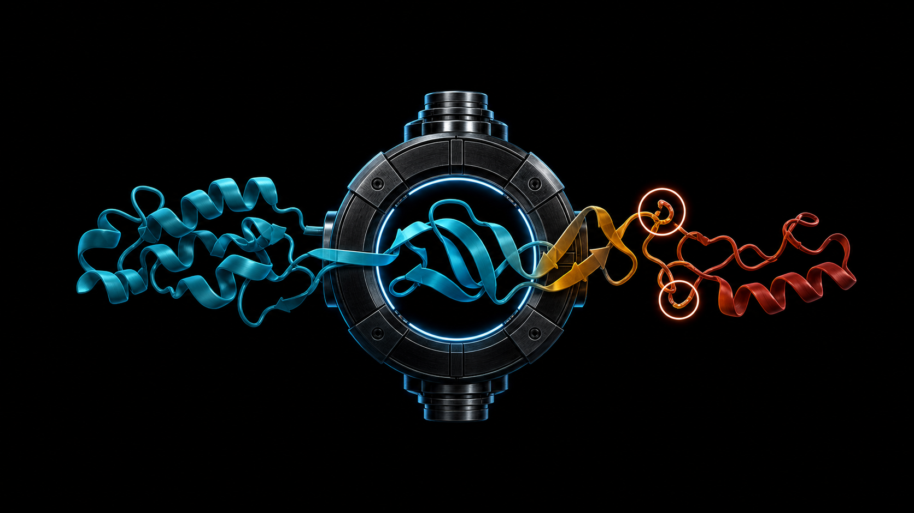
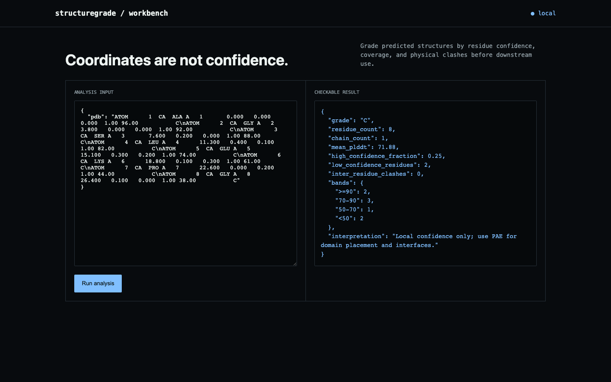

# structuregrade

**AlphaFold and PDB confidence and geometry quality gate.**



Grade predicted structures by residue confidence, coverage, and physical clashes before downstream use.



## What ships

- A deterministic domain analysis engine with explicit scope
- JSON API and responsive local browser workbench
- CLI demo and file-driven analysis
- Docker image, unit tests, and GitHub Actions matrix
- No API keys and no uploaded user data

## Run it end to end

```bash
python -m venv .venv && source .venv/bin/activate
python -m pip install -e .
structuregrade demo
structuregrade serve
```

Open <http://127.0.0.1:8090>. Analyze your own JSON input with `structuregrade analyze input.json`.

## API

- `GET /api/demo` returns the committed fixture and result.
- `POST /api/analyze` runs the same engine on a JSON body.

## Current basis

- [AlphaFold confidence guidance](https://alphafold.ebi.ac.uk/faq)

## Demo result

The eight-residue fixture averages 71.88 pLDDT but contains two residues below 50. `structuregrade` assigns C instead of letting the mean hide an uninterpretable tail, and reports zero geometry clashes.

## Scope

The parser reads PDB ATOM/HETATM coordinates and the confidence values AlphaFold writes to the B-factor column. pLDDT is local confidence, not interface or domain-placement confidence; PAE and domain-aware review remain necessary.

## Test

```bash
python -m unittest discover -s tests -v
```

MIT licensed.
